<div align="center">



<p>
  <a href="https://github.com/nitinkushwaha/dsh-mac-computer-use/releases"></a>
  
  <a href="https://github.com/awesome-dsh-plugin/awesome-dsh-plugin"></a>
  
</p>

</div>

**Mac desktop control (computer use) for DSH. Vision-first — no reliance on the accessibility tree.**

> **In one sentence:** a DeepSeek Harness (DSH) plugin that lets the model look at the screen and operate your Mac: list windows, take screenshots, find text with OCR, click, type, press keys, scroll, drag, and launch apps.
>
> **When to use it:** "What's on my screen right now?", "Click this for me in that app" — and Mac software that has no command line and can only be driven with the mouse.
>
> **Install:** on the DSH **Plugins** page, click **Add plugin** and enter `dsh-mac-computer-use` (an npm package; if npm can't be reached it automatically falls back to a China mirror), then restart DSH. The package ships prebuilt binaries (Apple silicon and Intel, macOS 11+), so there is nothing to compile. macOS only. For this fork, install from the release bundle URL in [Install](#install) instead — the npm name points at the upstream original.

> Previously named `dsh-cu`; renamed on 2026-10-18. Old links redirect here automatically, and the underlying command-line engine is still called `dsh-cu`.
> This is not the same project as [dsh-computer-use](https://github.com/988hj7tczd-oss/dsh-computer-use): that one drives the accessibility tree (cua-driver), this one works from screenshots.


*The desktop cursor: a solid blue arrow plus a "DSH" name tag carrying a display icon; while it works, the name tag spells out what it is doing. Same visual family as the browser cursor in [dsh-chrome-bridge](https://github.com/OrderG-X/dsh-chrome-bridge), which is semi-transparent and wears a globe icon.*

Eleven `desktop_*` tools + a self-contained Swift command line + a visible desktop cursor.

```
desktop_windows    desktop_observe    desktop_screenshot   desktop_find_text
desktop_click      desktop_type       desktop_key          desktop_apps
desktop_launch     desktop_scroll     desktop_drag
```

---

## Why build another one

Most computer-use plugins already available on DSH (`dsh-computer-use`, `dsh-mac-cua`, …) depend on the **macOS accessibility tree (AX)**. We measured what actually happens: **with the screen locked, AX reports 0 AXWindow elements for every application**, and everything recovers the moment you unlock — that is macOS behavior, not a driver bug ([full write-up](docs/locked-session-and-ax.md)). On top of that, some environments deny AX windows to third-party binaries altogether.

**Codex-style computer use takes the visual route**: screenshot → the model looks → act on coordinates. That route never touches AX, so it keeps working wherever AX does not. This repo is that route, plus:

| | |
|---|---|
| **OCR text targeting** | Runs locally on Apple's built-in Vision framework. `desktop_click(text="Sign in")` clicks straight through a text label |
| **Numbered elements** | `desktop_observe` numbers the clickable elements on the screenshot; the model just says "click number 7" |
| **Reports what changed** | After every click, type, key press or drag it also reports window changes (a "Save" sheet opened, a title changed, a window closed) — no extra screenshot needed just to confirm |
| **A visible cursor** | A blue cursor on screen follows every action, its name tag showing moves like "Click · Send"; same visual family as the browser plugin's cursor |
| **Retires itself when idle** | The cursor overlay leaves on its own after 60 idle seconds — no resident process left behind |
| **Single-file Swift** | Zero dependencies, easy to audit |

---

## Install

On the DSH **Plugins** page, click **Add plugin**, enter the package name `dsh-mac-computer-use`, then **restart DSH**. This is an npm package: when installed by name, DSH automatically switches to a China mirror (npmmirror) if the official npm registry is unreachable — nothing goes through GitHub. On this fork, enter the release bundle URL `https://github.com/nitinkushwaha/dsh-mac-computer-use/releases/latest/download/dsh-mac-computer-use.tgz` instead (requires GitHub access) — installing by the npm name would fetch the original upstream package, not this fork.

**Updating:** on DSH 0.2.2 and newer, open the plugin on the **Plugins** page and click **Update to …**; on older DSH versions, uninstall first, then add it again as above. A new release only becomes installable about a day after it is published (pnpm, which DSH uses to install plugins, refuses brand-new versions by default). In a hurry? Uninstall and install from the release bundle URL instead — though an install done that way cannot be updated with one click later.

The package bundles a prebuilt command-line engine and cursor overlay (Apple silicon and Intel, macOS 11+), so there is **no need to clone the repo or install Xcode**. On first use, grant DeepSeek Harness **Screen Recording** and **Accessibility** permissions in System Settings — the plugin's settings page has buttons that take you straight there.

Once installed, it shows up on the Plugins page as **Mac Desktop Control**. Opening it reveals a settings page: whether the plugin works and how many windows it can see, with a checklist covering the command-line engine, Screen Recording permission, Accessibility permission and the cursor overlay — anything missing gets its own button (which opens System Settings), plus a toggle for showing the action cursor on screen.

**Remote DSH setups:** the settings page polls the plugin's HTTP route on DSH's web server. When you reach DSH as `https://your-dsh-host` (reverse proxy, tunnel, or another machine of a private network), the route accepts only peers on a private/loopback address whose Host name is pinned in the plugin's config — edit `~/.dsh/dsh-mac-computer-use.json` (create it if missing) and add your host name:

```json
{ "showCursor": true, "panelHosts": ["your-dsh-host"] }
```

Without the pin the card shows "Could not read the plugin status" even though the desktop tools work. Cross-site requests stay rejected either way; DSH's own authentication still guards the route. A plain local setup (browser on the same Mac) needs no config.

**Build from source yourself** (only needed if you change the Swift code):

```bash
git clone https://github.com/nitinkushwaha/dsh-mac-computer-use.git
cd dsh-mac-computer-use
./install.sh
```

Requires Xcode Command Line Tools (`xcode-select --install`); the binaries are installed into `~/.dsh/bin/`. The plugin prefers the binaries bundled with the package; to use your own build instead, set `DSH_CU_BIN=~/.dsh/bin/dsh-cu` (and `DSH_CU_OVERLAY` for the cursor overlay). The release build script lives at `tools/build-bin.mjs`.

---

## What it looks like in practice

```
You: Show me what's on my screen
→ desktop_windows      returns the window list and coordinates
→ desktop_screenshot   the model sees the image

You: Click that "Sign in" button
→ desktop_click(text="Sign in")  OCR locates it → the event is delivered over (your real mouse never moves)
                                 reports back "afterwards: a new 'Welcome' window opened"

You: Work out 7+8 in Calculator
→ desktop_observe      screenshot + numbered elements
→ desktop_click(index=5) clicks element 5 ("7")
→ desktop_screenshot   one more screenshot to confirm
```

**The recommended workflow is `observe → click(index)`** — the model reads numbers straight off the image, far more reliable than estimating pixel coordinates.

---

## Under the hood

```
DSH tools (desktop_*)
      ↓ spawn
dsh-cu (single-file Swift)
      ├── winlist   CGWindowListCopyWindowInfo   ← window coordinates, zero permissions
      ├── observe   AX enumeration of clickable elements + numbered screenshot
      ├── shot      screencapture -l <window id>  ← captures the window itself, even when occluded
      ├── find      Vision framework OCR          ← finds text → clickable coordinates
      ├── clickat   CGEvent postToPid             ← never moves the real mouse, never steals focus
      ├── type/key  CGEvent                       ← CJK input supported
      ├── scroll/drag  CGEvent
      └── launch    NSWorkspace (background launch, no focus steal)
```

Background clicks actually land in their target window thanks to two details: the mouse event carries the target window id and window-relative coordinates (leave them out and both AppKit and Electron silently drop the event); and when the target is a backgrounded Chromium/Electron window (DSH itself, for example), the mouse-down must carry ⌘ before the page will accept it — the mouse-up and the click event itself carry no modifiers, so what the page sees is an ordinary click.

When capturing an application window, the tool captures that window itself by id (`screencapture -l`): it works even when the window is behind other windows or in the background, and what you see is exactly the window you are about to click; only if that fails does it fall back to capturing a screen region. Screenshots, element numbering and find-by-text all behave this way (thanks to [@Golden-Pigeon](https://github.com/Golden-Pigeon) for the PR).

Background typing works the same way: Accessibility first sets the target window as its own application's main window (without activating the app or stealing focus) so keystrokes have somewhere to land; Chromium/Electron accept only one character per keystroke while in the background, so text is delivered to them character by character. Background apps never receive menu-driven ⌘ shortcuts such as select-all, copy or paste.

The command line works on its own too:

```bash
dsh-cu winlist                    # list windows
dsh-cu tree <pid>                 # AX tree (available while unlocked)
dsh-cu observe <pid>              # screenshot + numbered elements
dsh-cu find "Sign in"             # OCR text → coordinates
dsh-cu clickat <pid> <x> <y>      # click (real mouse untouched by default)
dsh-cu type <pid> "hello"         # type text
dsh-cu selftest                   # full end-to-end self-test (see tools/selftest.sh)
```

---

## The cursor

`cursor/cursor-overlay.swift` is the desktop cursor overlay (installed to `~/.dsh/bin/dsh-cursor-overlay`): an NSPanel that never takes focus, lets clicks pass through, stays on top forever, and exits by itself after 60 idle seconds.

It shares **one visual family** with the browser cursor in [dsh-chrome-bridge](https://github.com/OrderG-X/dsh-chrome-bridge), so you can tell at a glance which surface is being driven:

| | Desktop (this repo) | Browser (dsh-chrome-bridge) |
|---|---|---|
| Arrow | Same shape, solid blue | Same shape, translucent light blue |
| Name tag | Display icon + DSH | Globe icon + DSH |
| While working | Tag expands to "DSH · Click · Send" | Tag expands to "DSH · Click · Sign in" |

**Motion** stays restrained, identically on both sides:

- One spring, one algorithm: it glides along a slightly curved path, stretches gently in its direction of travel (by at most 7%), tilts a touch, with the name tag trailing half a beat behind; on arrival it overshoots by at most two or three pixels before settling back
- On click it shrinks around the arrow tip and springs back (the aim point never moves), leaving a faint ripple ring
- While dragging it stays pressed (slightly shrunk, with a glow ring at the tip) and follows along; scrolling flashes the direction at the top right
- After 6 idle seconds it fades and retracts its name tag, staying out of the way; with the system's "Reduce motion" setting enabled, there is no animation at all

Overlay commands (write one line to `$(getconf DARWIN_USER_TEMP_DIR)dsh-cursor.fifo`, one FIFO per user account): `show x y` / `move x y` / `click [n]` / `down` / `up` / `scroll ±1` / `label <text>` / `hide` / `ping`.

---

## Known limitations

- **While the screen is locked:** screenshots show only the wallpaper, windows stop rendering, and AX reads no windows — that is macOS behavior, not a tool bug
- **Minimized windows and windows on other Spaces:** invisible and untouchable; bring the window back to the current Space first
- `desktop_click` delivers events to the target process by default (`postToPid`). A few apps ignore delivered events; add `global: true` to fall back to system-level events (which do move the real mouse)
- **Desktop clicks cannot drive Chrome** — Chrome ignores delivered synthetic events. Drive the browser with a CDP-style tool instead (such as [dsh-chrome-bridge](https://github.com/OrderG-X/dsh-chrome-bridge))
- Requires **Screen Recording** permission (used by `screencapture`) and **Accessibility** permission (used by click, type, keys, scroll and drag; while it is off, macOS silently drops those events, so the tools fail loudly instead of pretending to succeed)

---

## Field notes

[docs/locked-session-and-ax.md](docs/locked-session-and-ax.md) — how a locked screen disables AX across the board,
why that looks exactly like a driver bug, and the full day it took to confirm.

---

## Feedback

Found a problem or want a new feature? [Open an issue](https://github.com/nitinkushwaha/dsh-mac-computer-use/issues/new/choose). Including your DSH version and plugin version makes fixes land fastest.

## Maintaining this fork

This repository is an English fork of [OrderG-X/dsh-mac-computer-use](https://github.com/OrderG-X/dsh-mac-computer-use), kept as the `upstream` remote so upstream updates can be merged in. After upstream publishes new commits:

```bash
./tools/sync-upstream.sh
```

The script fetches upstream, merges `upstream/main`, and lists every line that still contains Chinese so it can be re-translated (`--check` previews without merging). If a push does not trigger CI on this fork, start it manually with `gh workflow run ci.yml`.

## License

MIT. `tools/dsh-cu.swift` is a self-contained single file — modify it directly if you like.

---

## About the cursor shape

The cursor is **drawn in code** (the `arrowPath` in `cursor/cursor-overlay.swift`): a rounded classic arrow with a blue gradient, sharing the exact same path as the browser side — no third-party asset files involved.